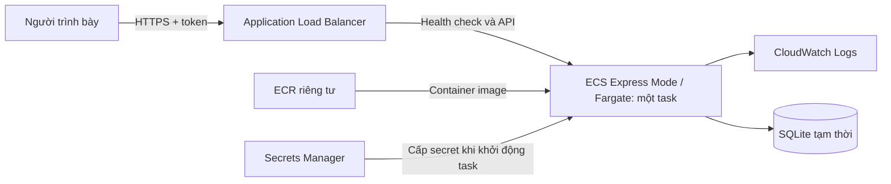

# Phương án triển khai AWS · chưa thực hiện

**Khuyến nghị:** Amazon ECS Express Mode trên Fargate cho một lần kiểm tra smoke test giới hạn người trình bày. Theo [thông báo AWS App Runner ngừng nhận khách hàng mới](https://docs.aws.amazon.com/apprunner/latest/dg/apprunner-availability-change.html), AWS đề xuất ECS Express Mode. ECS/Fargate thông thường phù hợp khi cần tự cấu hình tường minh network, load balancer và task definition.

## Các bước thực hiện trên AWS Console

1. Xác nhận phê duyệt, Region, ngân sách và người chịu trách nhiệm xóa tài nguyên. Dùng tài khoản không phải production và dữ liệu giả lập. Chạy thành công kiểm thử Docker local trước; gắn tag bất biến cho image đã kiểm tra.
2. Tạo ECR riêng tư và đẩy image theo [hướng dẫn AWS](https://docs.aws.amazon.com/AmazonECR/latest/userguide/docker-push-ecr-image.html). Không đưa credential vào lúc build.
3. Trong [ECS Express Mode](https://docs.aws.amazon.com/AmazonECS/latest/developerguide/express-service-create-full.html), chọn image đó; đặt container port `8000`, health path `/health`, một task (min/max bằng 1) cho demo SQLite có thời hạn. Ưu tiên private endpoint nếu người trình bày truy cập được; nếu cần public, giới hạn truy cập và dùng HTTPS cùng presenter token dài, khó đoán và ngắn hạn. Không chia sẻ token cho khán giả.
4. Đặt `WORKSHOP_HOSTED=1`, `WORKSHOP_MODE=demo`; truyền `WORKSHOP_TOKEN` từ Secrets Manager. Task execution role cần quyền kéo image ECR, ghi log và đọc đúng secret; infrastructure role quản lý tài nguyên Express Mode. Ứng dụng không cần quyền AWS task role ở chế độ này. Tắt hoặc không cấu hình truy cập model thật trong lần smoke test.
5. Khi health check xanh, chạy `python -m workshop demo --url <https-endpoint>` tại máy trình bày với `WORKSHOP_TOKEN` trong môi trường client. Xác nhận chat không token trả 401. Tìm request ID tương ứng trong CloudWatch Logs; kiểm tra trạng thái task và các mã 4xx/5xx của ứng dụng. Nếu endpoint lỗi, chuyển về demo local.
6. Sau buổi diễn tập/sự kiện, xóa service chuyên dụng và xác minh load balancer/network, ECR image/repository, secret và log group còn lưu. Đặt thời gian lưu log ngắn; không xóa tài nguyên dùng chung. Theo dõi ngân sách đến khi chi phí ổn định.

SQLite trong container cloud là **dữ liệu tạm thời**; khi task bị thay thế, các phiếu và quyết định có thể mất. Một replica không bảo đảm dữ liệu tồn tại qua mọi lần deploy. Không tăng replica hoặc dùng phiếu thật. Nếu cần chia sẻ dữ liệu, thay store bằng PostgreSQL hoặc DynamoDB có giao dịch/điều kiện ghi; kiểm thử lại duyệt đồng thời, idempotency và khởi động lại. Kho tri thức bất biến nhỏ có thể đóng gói cùng image; corpus thay đổi thì phát hành chỉ mục có phiên bản riêng. Phải thiết kế định danh và phân quyền trước khi phục vụ nhiều người dùng.

Các khoản chi gồm [Fargate, load balancer, CloudWatch và truyền dữ liệu](https://docs.aws.amazon.com/AmazonECS/latest/developerguide/express-service-overview.html), cùng registry, secrets và suy luận model nếu bật. Một task giúp giới hạn compute nhưng không có nghĩa toàn bộ hạ tầng miễn phí. Ưu tiên diễn tập local và dọn tài nguyên ngay sau khi dùng.

