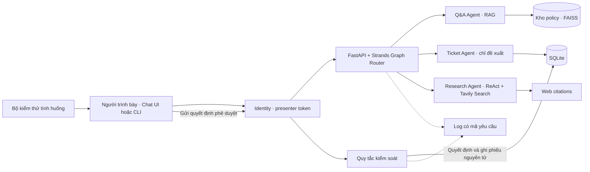

# Kịch bản trình bày · 30 phút

**Thông điệp mở đầu:** “Mô hình có thể đề xuất tạo phiếu. Hệ thống mới là nơi quyết định có cho phép tạo hay không.”

## Đối chiếu AgentCore theo thứ tự trình bày

Đây là **phần đối chiếu kiến trúc**, không phải ứng dụng AgentCore và không triển khai AgentCore. Tham khảo [tài liệu dành cho nhà phát triển AgentCore](https://docs.aws.amazon.com/bedrock-agentcore/latest/devguide/).

| Thứ tự | Thành phần trong app local | Liên hệ với AgentCore | Trách nhiệm của ứng dụng |
|---|---|---|---|
| 1 · Runtime | `tools.py`: Strands Graph router phân luồng sang ba agent chuyên biệt | Runtime lưu trữ agent và quản lý hạ tầng thực thi | Logic của graph, API và lựa chọn model |
| 2 · Identity | `identity.py`: token tùy chọn cho người trình bày | Identity hỗ trợ quản lý truy cập tới tài nguyên | Phân quyền người dùng/tenant và cấu hình nhà cung cấp danh tính |
| 3 · Gateway | `tools.py`: `search_policy`, `draft_ticket` và `search_web`/Tavily | Gateway cung cấp các công cụ, tích hợp được quản lý | Logic công cụ, kiểm tra dữ liệu và quyền tối thiểu |
| 4 · Policy | `policy.py`: yêu cầu phê duyệt tường minh, có thời hạn; từ chối thì không ghi phiếu | Policy quản lý việc gọi công cụ | Trải nghiệm duyệt, lưu quyết định và bảo đảm giao dịch |
| 5 · Memory | `memory.py`: lưu yêu cầu chờ duyệt và phiếu qua lần khởi động ứng dụng | Memory lưu và truy xuất ngữ cảnh hội thoại | Phiếu và quyết định là dữ liệu nghiệp vụ, không phải conversational memory; demo không lưu lịch sử hội thoại |
| 6 · Observability | `observability.py`: mã yêu cầu, sự kiện và thời gian xử lý | Observability cung cấp trace và tín hiệu vận hành | Ẩn dữ liệu nhạy cảm, instrumentation, cảnh báo và SLO |
| 7 · Evaluations | `tests/test_workshop.py` và `workshop demo`: test nghiệp vụ deterministic + kịch bản HTTP trên model thật | Evaluations đánh giá hành vi agent | Tiêu chí chất lượng và dữ liệu kiểm thử; test nghiệp vụ không đánh giá chất lượng mô hình |

## Kịch bản theo thời gian

| Thời gian | Thao tác | Điểm cần nhấn mạnh |
|---|---|---|
| 0–2 phút | Mở đầu bằng thông điệp và bài toán | “Mô hình có thể đề xuất tạo phiếu; hệ thống mới quyết định có cho phép tạo hay không.” |
| 2–10 phút | Demo Q&A, Ticket (từ chối rồi duyệt) và Research tìm web | Cho xem nhãn agent, nguồn policy và citation web bấm được; model thật, không giả lập. |
| 10–12 phút | Đi sơ đồ local | Chat UI → FastAPI/Strands Graph router → một trong ba agent → kết quả; Ticket vẫn qua policy/approval và SQLite. |
| 12–14 phút | Giải thích Strands Agents | Router dùng model phân loại; mỗi specialist có prompt và tool riêng, không gọi cả ba agent mỗi lượt. |
| 14–18 phút | Giải thích RAG indexing và truy vấn | Embed ba mục policy lúc khởi động; FAISS top-2 khi hỏi; context vào Q&A Agent. Đây chưa phải pipeline ingest/chunk tài liệu production. |
| 18–21 phút | Giải thích Ticket + Research | `draft_ticket` chỉ là đề xuất; phê duyệt idempotent mới ghi phiếu. Research dùng vòng ReAct: gọi `search_web` → Tavily trả nguồn → model tổng hợp; dữ liệu web không tin cậy. |
| 21–23 phút | Map bảy thành phần AgentCore | Đây là đối chiếu kiến trúc, không phải ứng dụng đang chạy trên AgentCore. |
| 23–26 phút | Phân tích AWS diagram | User → IGW → ALB → ECS/Fargate; chỉ ECR, Secrets Manager, CloudWatch, DynamoDB, IAM/Bedrock, NAT và EIP. |
| 26–29 phút | Walkthrough CloudFormation trên Console | Mở Events, Resources, Outputs; stack tạo hạ tầng mục tiêu nhưng ECS DesiredCount=0, ECR trống nên chưa phục vụ chat. |
| 29–30 phút | Kết luận | Model đề xuất; policy/app kiểm soát hành động; AWS stack chưa phải hosted app. |

**Phương án dự phòng:** Chạy thử CLI trước buổi trình bày. Nếu Docker không hoạt động, giữ ứng dụng local và trình bày Dockerfile/sơ đồ. Nếu AWS lỗi, dùng sơ đồ và kịch bản local; không nói là đã chạy cloud.

## Bốn trụ cột doanh nghiệp

| Trụ cột | Demo thể hiện | Việc cần làm nếu đưa vào production |
|---|---|---|
| Bảo mật | Dữ liệu giả lập; không nhúng credential; Docker chạy non-root; token tùy chọn; tách đề xuất khỏi thao tác ghi phiếu | TLS, SSO/OIDC, phân quyền theo danh tính, least privilege, luân chuyển secret, quét image, audit mạnh hơn |
| Mở rộng | Giới hạn kích thước input và số kết nối đồng thời; lập chỉ mục corpus một lần mỗi tiến trình | Dùng kho dữ liệu ngoài trước khi thêm replica; giới hạn admission và tuân thủ quota nhà cung cấp |
| Tin cậy | Health check, lỗi nhà cung cấp hiển thị rõ, duyệt idempotent theo giao dịch, kiểm thử khởi động lại | Kho bền vững dùng chung, backup, cảnh báo, khôi phục sự cố, kiểm thử tải/lỗi |
| Tối ưu chi phí | Corpus nhỏ, top-2 retrieval; router thêm một lần gọi model, Research có phí web search | Theo dõi token và latency; tính compute, load balancer, registry, log, mạng, secret và inference |

## Quyết định thiết kế đáng lưu ý

- Dùng một router và ba agent chuyên biệt; chỉ Research dùng web ngoài, Q&A chỉ dựa trên policy nội bộ, Ticket chỉ tạo draft.
- Tách lập chỉ mục khỏi xử lý từng truy vấn; chỉ mục FAISS tạo một lần lúc khởi động.
- Chỉ agent đề xuất nội dung phiếu; API kiểm tra danh tính và chính sách trước khi SQLite ghi dữ liệu.
- Quyết định phê duyệt có thời hạn, ghi một lần; từ chối không thể chuyển thành duyệt, duyệt lại trả cùng mã phiếu.
- AWS và AgentCore trong tài liệu là phương án/đối chiếu khái niệm, không phải tài nguyên đã triển khai.

